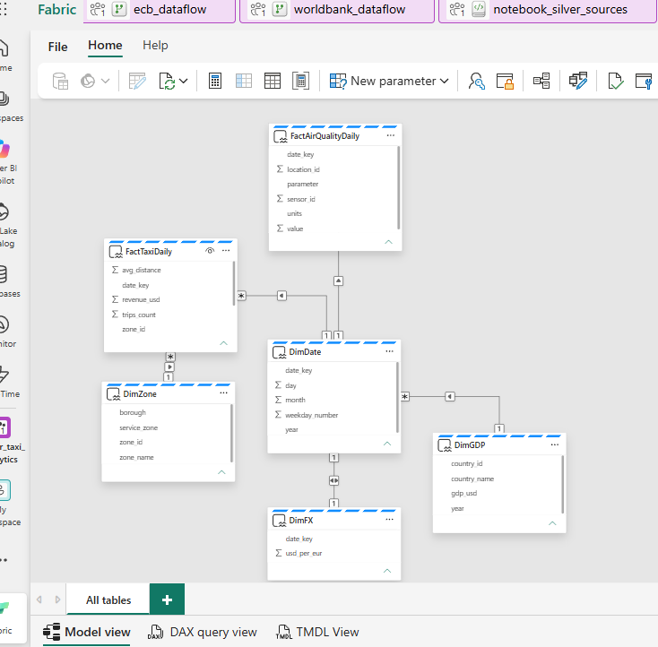
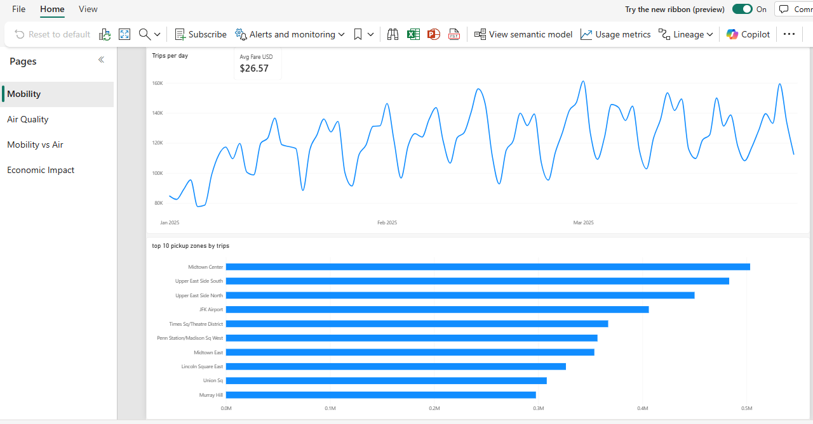
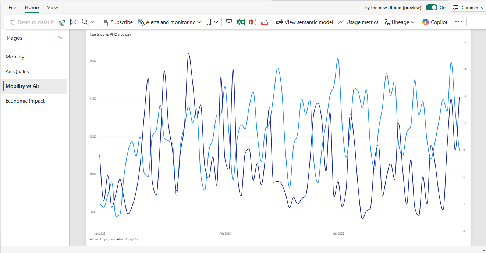

# NYC Air & Taxi Analytics

Course project for Itransition (Data Engineering group). Microsoft Fabric.

Made an app to see taxi trips, air quality and money data in one place. Period: January - March (2025).

Data I used:
- NYC yellow taxi trips
- Air quality from OpenAQ
- USD/EUR rate from ECB
- US GDP from World Bank

## How it works

It works with the medallion architecture:

- **Bronze** (`lh_bronze`) - raw data. Taxi files come with `pipeline_bronze`, ECB and World Bank with Dataflows Gen2, OpenAQ with `notebook_openaq`.
- **Silver** (`lh_silver`) - cleaned data. `notebook_silver` for taxi, `notebook_silver_sources` for the rest.
- **Gold** - `notebook_gold` makes a daily taxi table, then the star schema is built in the warehouse `wh_gold` with one procedure:

```sql
EXEC dbo.load_star_schema;
```

- **Report** - semantic model `sm_nyc_taxi_air` and report `r_nyc_taxi_air` with 4 pages.


## Star schema



| Table | Rows | One row = |
|---|---|---|
| FactTaxiDaily | 21 536 | day + pickup zone |
| FactAirQualityDaily | 444 | day + sensor + pollutant |
| DimDate | 90 | day |
| DimZone | 265 | taxi zone |
| DimFX | 90 | day (USD for 1 EUR) |
| DimGDP | 66 | year |

Facts are connected to DimDate by `date_key`, taxi to DimZone by `zone_id`, DimFX to DimDate by date (1:1), DimGDP to DimDate by `year`.

ECB has no rates on weekends, so in DimFX every day takes the last known rate (Saturday and Sunday get Friday's rate).

Measures:
- `Avg Fare USD` = revenue / trips
- `Revenue USD` = sum of revenue
- `Revenue EUR` = every day's revenue divided by that day's rate, then summed

Stations:

| id | Station | Where | Measures |
|---|---|---|---|
| 384 | CCNY | Manhattan | PM2.5 |
| 628 | Maspeth | Queens | PM2.5 |
| 857 | Fort Lee Near Road | New Jersey | PM2.5, NO2 |
| 1122 | Jersey City | New Jersey | NO2 |

## Dashboards

1. **Mobility** - trips per day, average fare, top 10 pickup zones
2. **Air Quality** - PM2.5 and NO2 by day and station
3. **Mobility vs Air** - trips and PM2.5 on one chart
4. **Economic Impact** - revenue in USD and EUR, US GDP by year





Fakts about the data:
- trips go up on working days and down on weekends, every week
- average fare is about $26.57
- most pickups are in Manhattan and at the airports
- PM2.5 does not follow this weekly pattern, so by day I don't see a strong link between taxis and PM2.5
- EUR revenue is a bit lower than USD because 1 EUR costs more than 1 USD

## Cleaning

Taxi trips:
- only trips with `total_amount > 0`
- only pickups from 2025-01-01 to 2025-03-31 (files have some trips with wrong years)
- dropoff must be after pickup
- duplicates removed

Other sources: correct types (date, double, int) and duplicates removed.


## Security

The OpenAQ key is only in `lh_bronze/Files/secrets/openaq_key.txt`. It is not in the code and not in Git.

## How to run

1. Bronze: `pipeline_bronze`, `ecb_dataflow`, `worldbank_dataflow`, `notebook_openaq`
2. Silver: `notebook_silver`, `notebook_silver_sources`
3. Gold: `notebook_gold`, then `EXEC dbo.load_star_schema;` in `wh_gold`
4. Refresh `sm_nyc_taxi_air`

## How to add more

- New taxi month: add the file to `pipeline_bronze` and run again.
- New station or pollutant: change `LOCATION_IDS` or `PARAMETERS` in the first cell of `notebook_openaq`.
